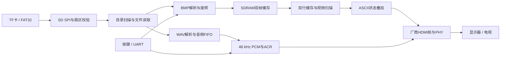

# FPGA-player：TF卡 HDMI 图像与音频播放器

FPGA-player 是基于安路 HX4S20 开发板（EG4S20BG256）的硬件播放器。它从 FAT32 格式的 TF 卡读取图片和背景音乐，通过 HDMI 同时输出画面与声音，适用于电子相册和图片展示。文件读取、图片解码、旋转、帧缓存和播放控制由 Verilog-2001 RTL 实现，HDMI 发送使用厂商 IP。

## 作品功能

| 功能 | 规格与操作 |
|---|---|
| 图片识别 | 自动扫描 FAT32 根目录，收录最多16张640×480、未压缩24/32-bit BMP |
| 图片播放 | 按目录顺序播放；支持上一张、下一张、自动轮播，周期1—60秒 |
| 图像旋转 | 0°、90°、180°、270°；90°/270°缩采样为360×480并水平居中 |
| 缓存显示 | SDRAM双帧缓存、双行缓存、帧边界换图，HDMI输出640×480 |
| 背景音乐 | 根目录首个48 kHz、双声道PCM16 WAV循环播放，支持音量和静音 |
| 本地控制 | 四个按键执行切图、轮播、旋转及长按复位 |
| 串口控制 | 115200、8N1，设置播放参数并查询状态 |
| 状态显示 | 画面左上角ASCII状态、四个状态LED及串口状态快照 |

以上为源码实现范围。**当前23项功能自检已有对应源码的通过记录，主工程布局布线后的setup/hold满足现有约束，主工程和HDMI诊断均已生成本地候选bit；尚未完成硬件验收。** SDRAM封装位置告警及外部IO、真实启动和整机运行仍需确认。最新批次、候选文件和待完成内容见[当前项目状况](docs/当前项目状况.md)，修复前完整回归见[验证记录](docs/verification.md)。

## 系统原理



新图片写入非活动帧，完整装载后在视频帧边界切换。音频采用有界分块读取，与图片共享TF链路。各时钟域通过FIFO和握手传递数据、控制及状态，详细协议见[系统设计](docs/design/README.md)。

## 准备与使用

准备HX4S20开发板、对应下载器、TF卡及读卡器、HDMI显示设备；串口控制另需与板卡电平匹配的USB转TTL串口。TF卡使用FAT32，将至少4张易区分的合法BMP及一个合法WAV放入根目录。文件按目录出现顺序处理，不按名称排序。

主工程为 [src/td_project/lean_player.al](src/td_project/lean_player.al)，顶层为 `lean_player_top`。板级连线、素材要求、按键、LED、UART协议及演示步骤见[使用说明](docs/使用说明.md)。下载前须先完成[验证与上板](docs/验证与上板.md)中的时序、原语和引脚检查。

## 开发与复现

开发工具为Anlogic TD和ModelSim。已使用的本机版本是TD V6.2.168116、ModelSim-Altera 10.3c；脚本允许通过参数指定安装路径。从仓库根目录运行：

```powershell
& ./src/sim/run_p0.ps1 -Suite All
& ./src/td_project/run_synthesis.ps1 -Project lean_player
```

完整视频和整合仿真耗时较长，可按套件或单项运行。综合脚本默认只执行综合；加 `-PlaceAndRoute`可检查最终布线时序，两种模式均不生成或下载bit。默认综合结果的 `Passed`与`TimingMet`须分别检查。工具配置、日志及模型边界分别见[仿真说明](src/sim/README.md)和[工程说明](src/td_project/README.md)。

## 仓库导航

| 位置 | 内容 |
|---|---|
| [docs/](docs/README.md) | 使用说明、系统设计、验证状态、赛题与开发板原始资料 |
| [src/](src/README.md) | 正式RTL、器件IP包装、约束、TD工程和自检脚本 |
| [src/rtl/](src/rtl/README.md) | 模块导航与连接规则 |
| [reference/](reference/README.md) | 提供的实验例程、厂商IP、原始说明及素材 |

正式工程直接使用厂商HDMI加密核及其PHY/串行器包装，PLL和SDRAM包装保留参数来源注释。参考资料的来源和依赖路径见[参考资料说明](reference/README.md)。构建产物和个人开发笔记不纳入源码提交。
