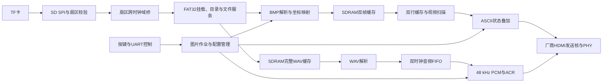
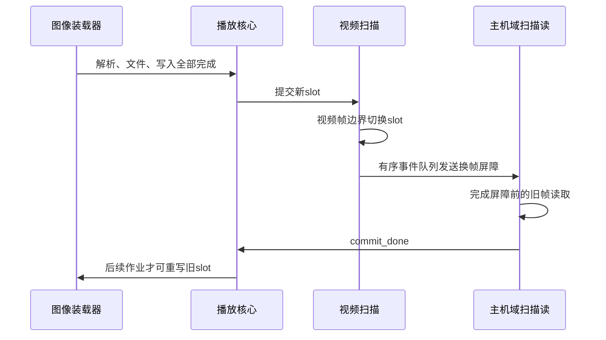

# FPGA-player 系统设计

FPGA-player是一套运行于HX4S20开发板（EG4S20BG256）的TF卡图片与背景音乐播放器。系统由Verilog-2001 RTL完成SD读取、FAT32文件访问、BMP/WAV解析、图像旋转、缓存和播放控制，再由厂商HDMI核输出画面与声音。本文说明实际源码中的结构、数据流和关键协议，操作方法见[使用说明](../使用说明.md)。

## 1. 系统组成

主工程为 [lean_player.al](../../src/td_project/lean_player.al)。[lean_player_top](../../src/rtl/top/lean_player_top.v)连接板级引脚、时钟复位、存储与HDMI；[lean_player_core](../../src/rtl/top/lean_player_core.v)协调文件读取、图片作业、换帧、音频和交互状态。

| 子系统 | 主要模块 | 职责 |
|---|---|---|
| 时钟与复位 | `pll_tree`、`reset_gen`、`reset_sync` | 生成各域时钟、处理锁定与复位释放 |
| SD物理读取 | `sd_storage`、`sector_cdc_bridge` | SD SPI初始化、容量识别、扇区读取、校验与跨域 |
| 文件服务 | `lean_media_source`、`lean_root_scan`、`fat32_*` | FAT32挂载、根目录扫描、簇链遍历及两个文件上下文 |
| 图片处理 | `bmp_parser`、`lean_image_loader` | 文件校验、像素解码、清帧、旋转与写入完成管理 |
| 图像缓存 | `lean_frame_memory`、`native_sdram_ctrl` | 仲裁扫描读与装载写，驱动器件集成SDRAM |
| 视频输出 | `lean_scanout`、`video_timing`、`lean_status_osd` | 行预取、帧边界换图、视频时序及状态叠加 |
| 音频输出 | `lean_audio_cache`、`lean_audio`、`wav_parser`、`audio_frame_fifo`、`samp_tick`、`acr_gen` | 完整文件缓存、WAV分块解码、循环、采样时基、音量及HDMI音频时钟恢复信息 |
| 播放控制 | `lean_player_ctrl`、`board_inputs`、UART收发 | 按键、命令、轮播计时及状态查询 |
| HDMI接口 | `player_hdmi`、`scanout_axis_bridge`、厂商IP | 把视频、音频及ACR送入发送核和串行输出层 |

播放器扫描FAT32根目录，收录最多16个非空BMP及首个非空WAV目录项，按目录出现顺序使用。图片限定640×480、未压缩24/32-bit BMP；背景音限定48 kHz双声道PCM16 WAV，完整文件不超过4 MiB。图片与音乐独立播放，切图不重启背景音。

## 2. 时钟、复位与跨域

50 MHz板载时钟经两个PLL产生五路时钟。`pll_tree`输入为 `I_clk_50m` 和高有效的 `I_pll_reset`，输出如下：

| 时钟输出 | 目标配置 | 用途 |
|---|---|---|
| `O_sd_card_clk` | 100 MHz | 当前播放器顶层未使用；SD控制逻辑使用板载50 MHz |
| `O_ext_mem_clk` | 83.333333 MHz | 文件系统、媒体解析、播放控制和SDRAM控制 |
| `O_ext_mem_clk_sft` | 83.333333 MHz，目标相对主机延后7 ns（210°） | SDRAM接口移相时钟 |
| `O_video_clk` | 25 MHz | 视频扫描、OSD及音频样本输出 |
| `O_hdmi_5x_clk` | 125 MHz | HDMI串行输出 |

两个PLL的真实锁定状态由 `O_sys_pll_locked`、`O_video_pll_locked` 引出。板级顶层通过带初值计数器产生16个50 MHz周期、约320 ns的启动复位，同时送给两个PLL。PLL reset独立于业务复位，防止启动过程形成循环依赖；长按KEY1产生业务全局复位，不重新启动PLL。

系统PLL包装中的 `O_clk_125m`、`O_clk_125m_sft` 两个端口实际配置为83.333333 MHz，计时参数使用这一频率。主机/SDRAM周期约12 ns，TD报告的硬SDRAM读采样路径约10.68 ns；SD域使用板载50 MHz。PLL分频为12，移相参数为 `CLKC2_CPHASE=6`，TD推导相位为210°。串口和轮播计时按83333333 Hz配置，按键消抖约20 ms。刷新默认以650个器件周期为命令间隔上限，在到期前预留活动行、读写排空、预充电及状态转换时间。控制器提前一个主机周期驱动写数据，再发送WRITE命令；SDC对该DQ写入路径设置两周期建立、单周期保持例外，命令、地址和掩码按7 ns单周期预算检查。

主机/视频、主机/SD之间采用异步FIFO、保持的载荷及同步链。SDC对这两组跨域的两个方向均施加10 ns纯数据路径上限，包含Gray指针。域内路径、主机/移相存储路径和同步链后级按各自时钟分析。

主工程将任一PLL失锁纳入全局业务复位条件，并组合存储域、视频域复位形成共享复位来源，各消费域再同步释放。掉卡走存储事务收尾与重新挂载流程，保持已提交帧，不使用掉卡事件清空全部业务逻辑。

| 跨域内容 | 连接方式 | 一致性要求 |
|---|---|---|
| 主机域↔SD域 | `sector_cdc_bridge`的请求、数据、终态及取消队列 | 事务携带context/tag，取消确认与读取完成分别处理 |
| 主机域↔视频域的扫描控制 | 提交FIFO、事件FIFO及回复FIFO | 行请求、释放和换帧屏障按序，旧读完成后才能复用帧 |
| 主机域→视频域音频 | 双时钟样本FIFO | 左右声道作为一帧传递，两侧共享flush来源 |
| 主机域→视频域配置与状态 | 29-bit快照FIFO | 多位配置整体传递，OSD在帧边界采纳 |

RTL功能模型只用于检查逻辑行为。PLL参数、移相、计数器初值映射、真实锁定与上电行为须由TD报告和硬件确认。

## 3. 从TF卡到文件字节

### 扇区读取与文件定位

`sd_storage`在SD域完成SPI初始化、CSD容量解析和CMD17扇区读取。读取器收齐512字节并通过校验后才发布该扇区，防止上层消费错误扇区的前半段。缓冲使用同步RAM读取，控制逻辑包含取数等待拍。超时、CRC错误、取消和失卡通过终态报告。

播放器顶层SD域为50 MHz；初始化分频250，对应200 kHz，工作分频6，对应8.333 MHz。SPI mode 0在上升沿采样。工作分频由顶层传入，不改变PLL、主机、SDRAM或视频时钟；实际卡片兼容性通过上板确认。

主机域的FAT32服务先检查分区/BPB、FAT布局、簇大小与地址边界，再扫描根目录。目录扫描跳过删除项、目录、卷标、LFN文本和空文件；长文件名对应的短别名项仍可提供扩展名、首簇和大小。它不按名称排序、不递归子目录；超出16张图片后记录目录溢出，首个WAV格式错误时不改选后面的WAV。

文件通过FAT簇链读取，支持碎片存放。挂载、目录扫描和在线文件读取分阶段使用共享的512字节扇区缓冲。簇链遍历另保留两份各512字节的FAT扇区缓存，命中时直接读取独立副本，未命中时替换最近未使用的一份；取消当前查询不会清空已有效的缓存，掉卡、重新挂载或卷几何变化时使其失效。文件读取器保留两个上下文：context0用于图片，context1用于音频，各自保存位置、簇链检查点和完成状态。

播放核心使用1024项、每项9位的同步RAM队列接收图片字节及末字节标志。准入图片数据扇区前至少预留512字节空间，已准入的扇区完整交付到队列，图片解析和SDRAM写入的反压由队列承接。暂停只在下一扇区准入前生效；FAT查询结束后也重新仲裁，使音频补充可及时获得读卡服务。

### 文件服务握手

文件服务采用 `valid/ready` 握手：两者同时有效才传输一项，等待接收时发送方保持有效标志和数据稳定。一次文件请求的主要过程为：

1. **Command**：请求方给出图片索引或音频选择、offset和length，握手后服务锁存请求。
2. **Begin**：同步读取文件描述符，发布文件大小、类型与开始错误。接收方采纳Begin后，成功请求才进入实际读取；Begin报错的请求不提供文件数据。
3. **Byte**：输出带context、文件offset和本次请求末字节标志的字节流；消费者可反压。
4. **Done**：已经进入读取的事务独立返回context、实际字节数、EOF和错误，末字节握手不代替Done。

取消按上下文保持并完成握手，底层取消确认与文件Done各自收尾。Begin成功后若掉卡，文件源仍需给出错误终态。重新挂载必须等待在途文件、扇区和取消操作全部结束，防止上一轮结果混入下一轮。

## 4. 图片解码、旋转与存储

### 像素处理

`bmp_parser`校验BMP签名、DIB、planes、bpp、宽高、像素偏移、行跨度及文件边界，支持正/负高度。几何和长度运算分拍执行，期间暂停输入。解析器把BMP行序与颜色顺序转换为规范坐标 `(x,y)` 和 `RRGGBBAA`；装载器只接受640×480图像，并写成32-bit的 `ffRRGGBB`，不进行alpha混合。

装载开始时锁存目标图片、旋转档及目标帧。0°/180°会覆盖完整640×480区域，直接写入像素；90°/270°先清黑左右各140像素的边框，再写入中间360×480图像，减少额外存储写入。错误或不完整图像不会提交，完整帧仍须等解析、文件终态及实际写入全部退休后才能用于显示。

以左上角为原点，x向右、y向下，坐标映射如下：

| 旋转档 | 目的坐标 `(x',y')` | 显示区域 |
|---|---|---|
| 0：0° | `(x,y)` | 640×480 |
| 1：顺时针90° | `(499-v,u)` | 360×480，左右各140像素黑边 |
| 2：180° | `(639-x,479-y)` | 640×480 |
| 3：顺时针270° | `(140+v,479-u)` | 360×480，左右各140像素黑边 |

90°/270°时丢弃 `x mod 4 = 3` 或 `y mod 4 = 3` 的源像素，对保留像素计算 `u = 3×floor(x/4) + (x mod 4)`、`v = 3×floor(y/4) + (y mod 4)`。这相当于先把640×480按3/4最近邻采样为480×360，再旋转为360×480，适配固定输出画面，无需缓存完整的中间旋转图。

### 双帧缓存与写入完成

器件集成SDRAM容量为2M×32-bit，帧地址以32-bit字为单位：

| 存储区 | 基址（32-bit字地址） | 长度 |
|---|---:|---:|
| slot0 | 0 | 307200字 |
| slot1 | 307200 | 307200字 |
| 保留空隙 | 614400 | 434176字 |
| 完整WAV缓存 | 1048576（0x100000） | 1048576字（4 MiB） |

像素字地址为 `slot_base + 640×y' + x'`，双帧合计2457600字节。装载只写非活动帧，扫描只读活动帧。

播放核心先将扫描读与音频缓存读仲裁到同一个寄存接口，扫描优先；缓存读的tag最高位为1，返回时据此分流，扫描tag最高位保持0。写接口仲裁音频缓存写与图片写，缓存写优先，阻塞期间保持命令和数据不变。`lean_frame_memory`再对读、写请求采用读优先，以保障显示供数。写入计数从命令接收开始，直至底层返回写完成才扣除；核心的写入完成屏障还包含新增的写接口寄存器。

装载成功必须同时满足BMP解析结束、文件读取终态到达、全部存储写入完成及像素数正确。0°/180°应写307200个图像像素，90°/270°应写172800个。失败时取消并收尾，保持活动帧不变，不发布部分图片。

## 5. 视频扫描与安全换帧

视频有效区域640×480，总时序800×525，25 MHz像素时钟对应约59.52 Hz。`lean_scanout`使用两个640×24-bit行缓存，主机域从SDRAM预取，视频域按像素时钟输出，从而缓冲存储访问延迟。

每份完整行回复携带帧号、行号和slot身份。视频域在行首确认身份与就绪状态，整行采用同一判断；迟到的行输出黑色并计数，避免一行前后混入不同数据。事件队列溢出时锁存故障，停止不安全的缓存复用。

换帧包含两个不同的完成点：视频采用新帧，以及主机获得旧帧可重写的确认。

仅在帧边界改读地址仍可能遇到旧读请求排队；屏障确认把这些请求一并收尾，防止旧帧被过早覆盖。播放核心收到 `commit_done` 后才更新已显示图片索引、旋转档和活动slot。

## 6. 背景音乐缓存与播放

正式配置为 `lean_player_core.AUDIO_CACHE=1`。首图换帧确认后，`lean_audio_cache`通过context1发起一次offset0、length为0xffffffff的完整WAV读取，把文件原始字节按little endian打包到SDRAM后半区，最后不足4字节的字补零。它检查文件大小、连续offset、EOF和实际传输长度；文件成功结束且所有写入退休后才发布缓存就绪。超过4 MiB或读取失败会报告音频错误，不退回TF流式播放，图片流程可继续。

缓存准备期间暂停新图片数据扇区的准入，已提交首图继续显示；新的图片操作可能排队。音乐在缓存就绪后开始。随后缓存模块向`lean_audio`提供原有Command/Begin/Byte/Done接口，2048字节补充和文件循环均在SDRAM中完成，不再占用TF读卡带宽。缓存和图片共用SDRAM，扫描读取保留优先权。

媒体移除后撤销缓存并flush音频FIFO，在途SDRAM读返回仍须排空。重插后先提交该卡首图，再重新缓存WAV。`AUDIO_CACHE=0`选择TF流式读取接口，用于文件供数与调度测试；正式工程使用默认缓存配置。

`lean_audio`从选定WAV读取RIFF/chunk，校验PCM格式、采样率、声道和数据对齐。PCM16通过低位补8个0转换为PCM24，以保持归一化幅度；左右声道一起进入8192帧双时钟FIFO，约可缓存170.7 ms音频。

48 kHz双声道PCM16的素材数据率为192000字节/秒。音频每次请求最多2048字节，FIFO低于6144帧时补充，达到6144帧后可启动播放，短文件到EOF也可启动。6144帧约为128 ms音频；2048字节最多包含512个双声道样本帧，约10.67 ms音频。

到文件尾后等待解析收尾，再从缓存offset0重新解析并循环，正常循环不flush FIFO。缓存播放期间音乐不再占用TF链路，图片与音频通过SDRAM仲裁并发访问。

视频域由25 MHz时钟生成48 kHz采样使能。每次采样从FIFO取左右声道，应用有符号移位音量与独立静音；播放已启动但FIFO无数据时输出零样本并累计欠载。音量档1—4分别为1/8、1/4、1/2、原幅，档0输出静音。

HDMI同时接收PCM24和ACR信息。ACR用于接收端恢复音频时钟，参数N=6144、CTS=25000，对应25 MHz像素时钟下的48 kHz音频。图片切换与音频没有逐图时间绑定，音乐持续独立循环。

## 7. 播放控制、交互与状态

控制模块保存用户目标及配置，图片作业开始时再锁存一份index/rotation/slot。作业执行期间新按键或UART命令可以更新下一目标，当前作业仍按已锁存参数完成，避免同一帧混用两套旋转配置。

轮播在已有有效画面、图片流程空闲且开启时计时；换图或忙期间重新计时。默认轮播开启、周期5秒、旋转0°、音量4且未静音，配置保存在运行寄存器，复位后恢复默认值。

普通按键采用消抖后的释放事件；KEY1长按全局复位由独立50 MHz逻辑检测。UART使用完整行解析，合法命令执行后回复，非法或超长行整行拒绝。协议采用一问一答，具体命令、按键和LED定义集中在[使用说明](../使用说明.md)。

OSD采用内置8×16 ASCII字模，叠加于左上角216×16区域。8-bit分区类型诊断字段与图片索引、图片数、轮播、已提交旋转、音量、静音、忙和错误组成29-bit快照跨到视频域。OSD在帧边界采纳，音频配置使用视频域已接收的待显示快照，均不直接采样主机域多位寄存器。

UART查询返回主机域快照，其中R是用户请求旋转；OSD的R是已提交画面的旋转，因此装载期间可以不同。OSD图片序号从1开始，UART的I从0开始，数值均为十六进制。周期只在UART返回，不在OSD显示。

## 8. 异常处理与实现边界

| 异常 | 源码处理方式 |
|---|---|
| BMP格式、尺寸或读写错误 | 装载收尾后不提交；有限次数尝试下一项，保留原有效帧 |
| WAV格式或读取错误 | 终止本次音频源处理并报告错误，不自动改选另一WAV |
| 掉卡 | 撤销目录，取消并等待旧I/O收尾；已提交帧继续扫描，重新挂载后从首图装载 |
| 行数据迟到 | 整行黑色并累计欠载 |
| 扫描事件队列溢出 | 锁存故障，阻止不安全的复用 |
| PLL失锁或KEY1长按 | 触发业务全局复位，PLL启动复位保持独立 |

播放核心的汇总错误码按优先级映射为1：SDRAM或扫描故障，2：图片错误，3：音频错误，4：目录/挂载错误。接口状态是故障分类，具体原因需检查对应模块的错误字段及测试日志。

PLL、片内RAM、集成SDRAM使用安路原语，HDMI使用厂商加密发送核及PHY包装，来源见[参考资料说明](../../reference/README.md)。功能自检模型不进入综合。测试步骤见[验证与上板](../验证与上板.md)，运行结果见[验证状态](../verification.md)。
